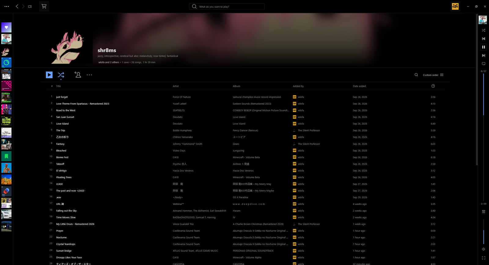
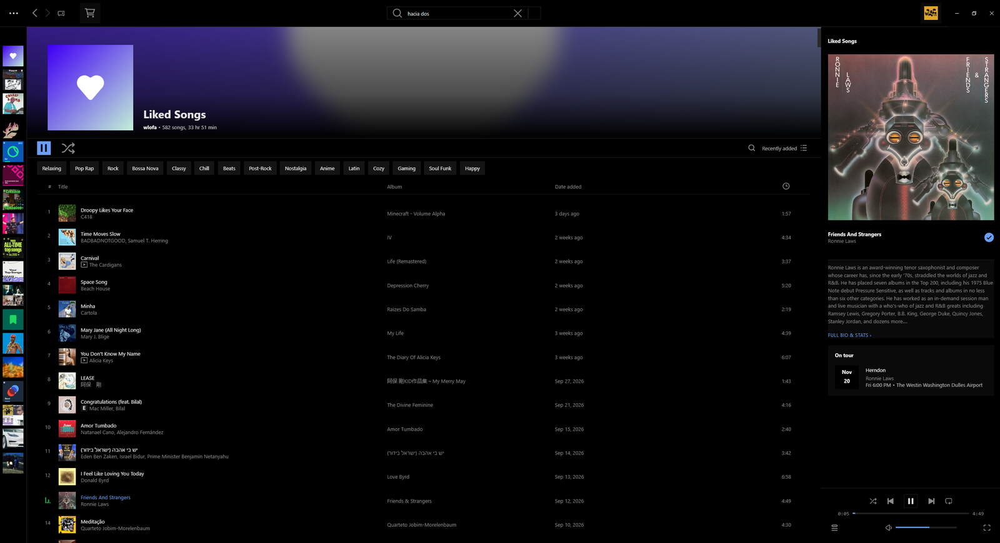

# AMOLED Compact

A minimal, flat AMOLED theme for [Spicetify](https://spicetify.app), inspired by foobar2000 and old desktop MP3 players. Pure black, thin dividers, square corners, and nothing on screen that isn't doing a job.





## Features

- **Cover-only library.** The left sidebar is a narrow column of covers, with no text and no filter chips.
- **Cover-art headers.** Playlist and album pages show the sharp cover next to the title, over a blurred, faded copy of the same art.
- **A player that changes shape.** With the Now Playing panel open, the player sits under the panel as a horizontal deck. Close the panel and it slides in as a vertical strip on the window edge. The timeline runs top to bottom, and the volume fills upward.
- **A quiet Now Playing panel.** It shows the cover, the title and artist, and a short artist bio. Click the bio for the full bio and stats.
- **Two color schemes.** `amoled` has a muted blue accent. `amber` has a warm accent that looks like an old LCD player.
- **Built to stay fast.** The rules avoid patterns that make Spotify recheck the page while you scroll or while music plays. See [Performance](#performance).

## Install

### From Marketplace

1. Open **Marketplace** in Spotify (the cart icon) and go to **Themes**.
2. Search for **AMOLED Compact** and click **Install**.

Marketplace also loads the theme's small script automatically.

### Manually

1. Download this repository. Copy the `AMOLED-Compact` folder into your Spicetify Themes folder:
   - **Windows:** `%APPDATA%\spicetify\Themes\`
   - **macOS / Linux:** `~/.config/spicetify/Themes/`

   `color.ini` and `user.css` should sit directly inside `Themes\AMOLED-Compact\`. Watch for an extra nested `AMOLED-Compact` folder if you use Windows' "Extract All".
2. Run:

   ```
   spicetify config current_theme AMOLED-Compact color_scheme amoled
   spicetify config inject_theme_js 1
   spicetify apply
   ```

To use the warm accent instead, run `spicetify config color_scheme amber`, then `spicetify apply`.

## First-time setup

- **Collapse the library once.** Click the icon at the top of the left sidebar. After that, the button to reopen it is hidden, and Spotify remembers the collapsed state.
- **Compact track lists.** On a playlist, click the list icon at the top right of the track list and choose **Compact**.

## What `theme.js` does

The theme ships one small script. It does two things:

- It reads the address of the current page's cover and passes it to the header, which draws the blurred backdrop from it. CSS can't show one image twice on its own. Without the script, headers are plain black.
- It asks Spotify to size the window buttons to the theme's top bar. Some Spotify builds ignore this request, so the theme also makes the top bar tall enough either way.

It runs for a few seconds after each page change, never continuously, and makes no network requests of its own.

## Settings

The top of `user.css` has quick settings:

| Setting | What it changes |
|---|---|
| `--ac-size` | text size (also change the `12px` in section 5) |
| `--ac-strip` / `--ac-strip-windows` | top bar height on macOS / Windows (also change `TITLEBAR` in `theme.js`) |
| `--ac-search` | width of the search box |
| `--ac-library` | width of the cover column (also change the matching `64` in section 6) |
| `--ac-rail` | vertical player width |
| `--ac-rail-art` | cover size at the top of the vertical player |
| `--ac-rail-volume` | volume slider length in the vertical player |
| `--ac-deck-height` | room kept under the panel for the horizontal player |
| `--ac-deck-lift` | space under the player's last row |
| `--ac-volume` | volume slider length in the horizontal player |
| `--ac-anim` | player slide-in speed (`0ms` turns it off) |
| `--ac-bio-lines` | lines of artist bio shown |
| `--ac-banner-height` | playlist/album header height |
| `--ac-header-art` | size of the cover in the header |
| `--ac-banner-opacity` | strength of the blurred backdrop (`0` turns it off) |
| `--ac-banner-blur` | backdrop blur (lower makes the cover easier to recognise) |
| `--ac-plays-align` | where the play counts sit in their column: `flex-start`, `center` or `flex-end` |
| `--ac-plays-label` | "Plays" over the counts: `center`, or `right` to line up with the digits' edge |

Colors are in `color.ini`. Corner rounding is set directly in section 5 (`border-radius: 0`) rather than as a setting, because applying a setting to every element measurably slows Spotify down.

After a change, run `spicetify apply`, or use `spicetify watch -s` to reload live while you edit.

## Compatibility

Built and tested in October 2026 on Spotify for Windows and macOS with Spicetify 2.46. Spotify changes its internal layout from time to time, and its class names differ between builds. AMOLED Compact avoids those class names where it can, and targets IDs, `data-testid` attributes and accessibility roles instead.

The CSS is split into numbered sections. If an update breaks something, delete the section causing it and run `spicetify apply`, and the rest keeps working. Sections 2 and 4 (frame and player) are the most ambitious. Without them, the player goes back to Spotify's normal bottom bar.

Please [open an issue](../../issues) with a screenshot if something looks wrong.

## Performance

AMOLED Compact avoids two patterns that make themes slow:

- **Rules that read inline styles and then restyle children or siblings.** Spotify changes inline styles on nearly every scroll frame and progress tick, so these rules get rechecked constantly.
- **`var()` in rules that apply to every element.** Resolving a variable on every element adds up.

In testing, scrolling cost about 0.1 ms of restyling per frame and progress updates about the same, close to no theme at all. Please keep that in mind if you send a pull request.

## License

[MIT](LICENSE)
